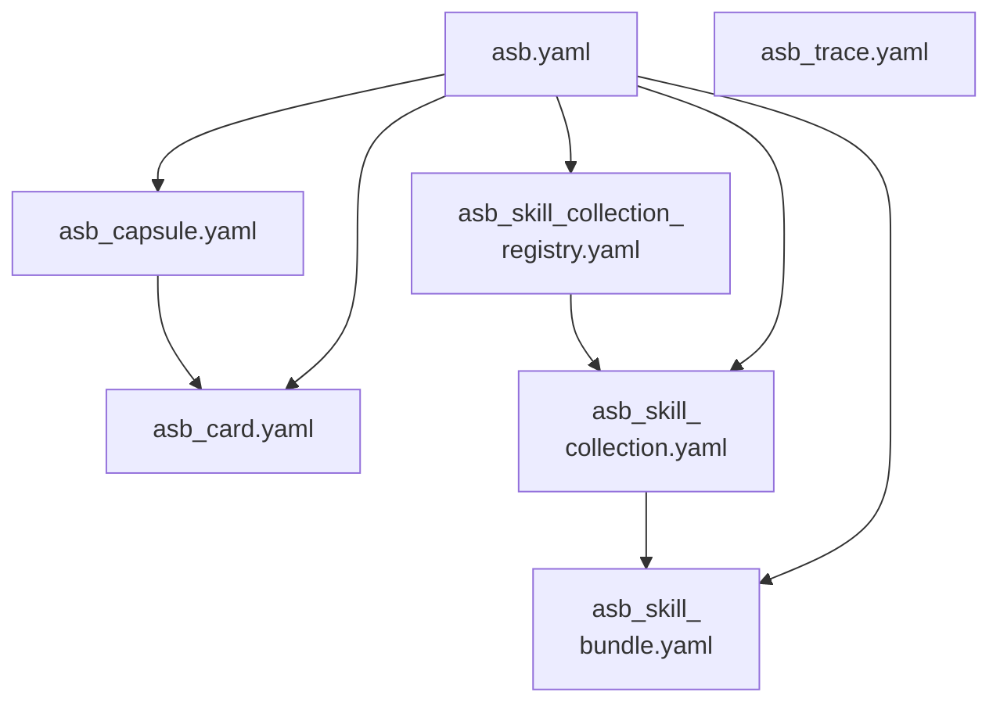

# The format

ASB Schema is a family of six artifacts that describe scientific tasks extracted from research papers or projects, and the skills those tasks use. Each artifact is defined by one LinkML file in `src/asb_schema/`. A seventh file, the umbrella `asb.yaml`, defines no class and imports five of the six.

## The six classes

All identifiers start with `https://w3id.org/holobiomicslab/asb-schema/`.

| Artifact | Root class | File and version | `id` segment | Required slots |
|---|---|---|---|---|
| [Task card](task-card.md) | `ASBTaskCard` | `asb_card.yaml` 0.2.0 | `card/v0.2` | 15 of 50 |
| [Capsule](capsule.md) | `SciTaskCapsule` | `asb_capsule.yaml` 0.1.0 | `capsule/v0.2` | 3 of 8 |
| [Skill bundle](skill-bundle.md) | `SkillBundle` (with `ASBSkill`, `ASBTool`) | `asb_skill_bundle.yaml` 0.2.0 | `skill-bundle/v0.2` | 3 of 15 |
| [Skill collection](skill-collection.md) | `SkillCollection` | `asb_skill_collection.yaml` 0.3.0 | `skill-collection/v0.3` | 6 of 25 |
| [Collection registry](skill-collection.md#collection-registry) | `SkillCollectionRegistry` | `asb_skill_collection_registry.yaml` 0.2.0 | `skill-collection-registry/v0.2` | 3 of 7 |
| [Exploration trace](exploration-trace.md) | `ExplorationTree` | `asb_trace.yaml` 0.1.0 | `trace/v0.1` | 1 of 3 |

The artifacts follow one another:

1. A producer reads a paper and writes one **task card** per bounded task, and an **exploration trace** of the paper's research path.
2. A **capsule** packages a card with its evidence and an RO-Crate metadata file.
3. A card names its skills and tools as text. A **skill bundle** describes each skill once it has been identified across several papers; `MergeAuditRecord` records each deduplication decision.
4. A **skill collection** releases a curated set of skills and tools under a license, and the **collection registry** lists the released collections.

The card records an outcome; the trace records the path to it, dead ends included. Release, license and credit are recorded on the collection.

## Import graph

<figure class="asb-figure" markdown>

<figcaption markdown="span">Import graph of the seven LinkML files. An arrow points from the importing file to the imported file. `asb_trace.yaml` stands alone.</figcaption>
</figure>

!!! tip "Validate each artifact against its own file"
    Slot names are global in LinkML: when files are loaded together, a slot name defined in two of them keeps one definition. Loading `asb.yaml` makes `ASBTaskCard.skills` and `tools` optional, for example. Each artifact is therefore validated against its own schema file. See [Conformance](../reference/conformance.md).

## Generated files

`generate.sh` writes, beside the LinkML sources:

- one JSON Schema file (draft 2019-09) per schema file, from `asb_card.schema.json` to `asb_trace.schema.json`, generated by `asb_schema.jsonschemagen`;
- `context.jsonld`, a JSON-LD context for the skill-bundle terms;
- the [field reference](../reference/index.md) of this site.

In the JSON Schema files, each class is a closed definition under `$defs`, and the root object is open. Validation targets the class under `$defs`; the [JSON Schema roots](../reference/conformance.md#json-schema-roots) table gives the target for each file.

## Versioning

Three numbers apply, each to a different object:

- the package `asb-schema` follows Semantic Versioning (0.4.0); before 1.0 a minor release may change a schema so that previously valid data fails;
- each LinkML file has its own `version` and a versioned `id`;
- each task card records `schema_version` and `scitask_version`, the card-format versions its producer followed.

The full policy and the identifier namespaces are on [Conformance](../reference/conformance.md#versioning-policy).

## Beyond the six classes

The reference pipeline writes further files beside these artifacts, in its own runtime formats: typed evaluation checks (`eval.json`), rubrics, build manifests and a claim ledger. It also exports to ASTRA, RO-Crate, Agent Skills and workflow languages. [How the artifacts are produced](../pipeline/index.md) lists them, and [Interoperability](../interop/index.md) describes each export.
