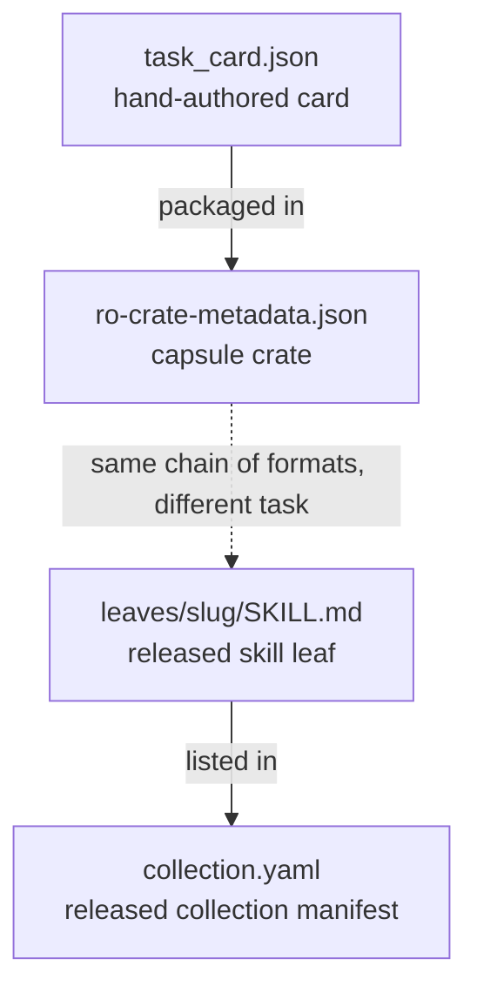

# Worked example

One task card and the three formats that follow it in a release: the capsule that packages the card, a released skill leaf and the collection manifest that lists the leaf. The card and the capsule crate are hand-authored for this page and describe a hypothetical analysis. The skill leaf and the manifest are excerpts of public files in [asb-skill-collections](https://github.com/HolobiomicsLab/asb-skill-collections). The two halves show the same chain of formats, not one run.

<figure class="asb-figure" markdown>



<figcaption markdown="span">The four steps of the worked example. The first two files are hand-authored; the last two are released files.</figcaption>
</figure>

## 1. The task card

The card fills the 15 required slots and adds `task_kind`, `task_objective`, `crossref_doi`, `provenance_source`, `reproducibility_tier`, one evidence snippet and one artifact. The DOI `10.1000/example` is hypothetical.

<div class="asb-example" markdown>
<span class="asb-eyebrow">Example</span>

```json
{
  "task_id": "example-package__task_001",
  "title": "Count features removed by blank subtraction",
  "task_kind": "reproduction",
  "source_package": "example-package",
  "crossref_doi": "10.1000/example",
  "provenance_source": "published",
  "reproducibility_tier": "type-checked",
  "research_question": "How many features of the untargeted feature table come from the extraction blanks?",
  "finding": "Blank subtraction with a fold-change threshold of 3 removes 412 of 2,180 features.",
  "task_description": "Apply blank subtraction to the feature table and report the number of features kept and removed.",
  "task_objective": "Reproduce the count of features that remain after blank subtraction.",
  "inputs": ["feature_table.csv: peak areas for 24 samples and 3 extraction blanks"],
  "expected_outputs": ["filtered_feature_table.csv", "blank_subtraction_summary.json"],
  "tools": ["pandas"],
  "skills": ["blank subtraction of an untargeted feature table"],
  "workflow_description": "1. Load the feature table. 2. Compute the mean area of each feature in the blanks. 3. Keep features whose mean sample area is at least 3 times the blank mean. 4. Write the filtered table and the counts.",
  "available_artifacts": [
    {
      "path": "data/feature_table.csv",
      "role": "raw_data",
      "indexable": false,
      "sha256": "ea76c5fc77b11b2aa38d7044764f9e204c2e31daa748d839192a126eff168858"
    }
  ],
  "evidence_snippets": [
    {
      "snippet_id": "snip_001",
      "source_path": "article/methods.md",
      "reason": "States the threshold and the count that the task reproduces.",
      "text": "Features with a sample-to-blank ratio below 3 were removed (412 of 2,180)."
    }
  ],
  "evaluation_strategy": {
    "direct_checks": [
      "filtered_feature_table.csv exists and has 1,768 feature rows",
      "blank_subtraction_summary.json reports 412 removed features"
    ],
    "expert_review": ["The threshold is applied to mean areas, as the methods state"]
  },
  "created_at": "2026-10-30T12:00:00Z",
  "schema_version": "0.18.0",
  "scitask_version": "0.1.1"
}
```

</div>

```bash
SCHEMA=$(python -c "from asb_schema import get_schema_path; print(get_schema_path('asb_card'))")
linkml-validate --schema "$SCHEMA" --target-class ASBTaskCard task_card.json
# No issues found
```

The card reads in four groups: what is asked (`title`, `task_objective`, `task_description`, `research_question`, `task_kind`), what the paper found (`finding`, `evidence_snippets`, `crossref_doi`, `provenance_source`), what is needed (`inputs`, `tools`, `skills`, `workflow_description`, `available_artifacts`) and how an attempt is checked (`expected_outputs`, `evaluation_strategy`, `reproducibility_tier`). The numbers of the finding also appear in the evidence and the direct checks, so a solver receives the task text and the evaluator keeps the card.

## 2. The capsule crate

A capsule directory holds `task_card.json` and an `ro-crate-metadata.json`. RO-Crate 1.1 asks for a metadata descriptor that points to the root, and a root `Dataset` with `datePublished`; `name`, `description` and `license` are recommended[^rocrate].

<div class="asb-example" markdown>
<span class="asb-eyebrow">Example</span>

```json
{
  "@context": "https://w3id.org/ro/crate/1.1/context",
  "@graph": [
    {
      "@id": "ro-crate-metadata.json",
      "@type": "CreativeWork",
      "conformsTo": {"@id": "https://w3id.org/ro/crate/1.1"},
      "about": {"@id": "./"}
    },
    {
      "@id": "./",
      "@type": "Dataset",
      "name": "Capsule for example-package__task_001",
      "description": "Hand-authored capsule holding one task card about blank subtraction.",
      "datePublished": "2026-10-30",
      "license": {"@id": "https://creativecommons.org/licenses/by/4.0/"},
      "hasPart": [{"@id": "task_card.json"}]
    },
    {
      "@id": "task_card.json",
      "@type": "File",
      "name": "Task card",
      "encodingFormat": "application/json"
    },
    {
      "@id": "https://creativecommons.org/licenses/by/4.0/",
      "@type": "CreativeWork",
      "name": "CC BY 4.0"
    }
  ]
}
```

</div>

ASB Schema validates `task_card.json`; RO-Crate tooling checks the crate. Crates written by the reference pipeline add `urn:asb:` nodes for the task, tools, inputs and outputs and a `CreateAction` that links them ([Capsule](capsule.md#ro-crate-metadata)).

## 3. A released skill leaf

The front matter of `collections/metabolomics/v2/leaves/metabolite-record-deduplication/SKILL.md`, shortened:

<div class="asb-example" markdown>
<span class="asb-eyebrow">Example</span>

```yaml
name: metabolite-record-deduplication
description: Use when you have extracted metabolite records from two or more public
  metabolomics databases (e.g., HMDB, MassBank, METLIN) and need to merge them into
  a single reference database.
license: CC-BY-4.0
metadata:
  edam_operation: http://edamontology.org/operation_3364
  edam_topics:
  - http://edamontology.org/topic_0639
  - http://edamontology.org/topic_3172
  tools:
  - openNAU
derived_from:
- doi: 10.21147/j.issn.1000-9604.2023.05.11
  title: OpenNAU
evidence_spans:
- An open-source analysis software for untargeted metabolism data (openNAU) was constructed
provenance:
  collection: https://w3id.org/holobiomicslab/asb-skill/collection/metabolomics/v2
```

</div>

`name`, `description`, `license` and `metadata` follow the Agent Skills layout[^agentskills]; `derived_from`, `evidence_spans` and `provenance` carry the source article, verbatim evidence and the collection the leaf belongs to.

## 4. The collection manifest

The leaf is listed by slug in `collections/metabolomics/v2/collection.yaml`, which validates closed against `SkillCollection`:

```yaml
'@id': https://w3id.org/holobiomicslab/asb-skill/collection/metabolomics/v2
title: ASB Metabolomics Skill Collection v2 (expansion)
version: 2
license: CC-BY-4.0
skills_count: 5859
skills:
- 2d-nmr-pulse-sequence-implementation
# ...
- metabolite-record-deduplication
```

See [Skill collection](skill-collection.md) for the full field list.

[^rocrate]: Research Object Crate (RO-Crate), "Root Data Entity", RO-Crate 1.1 specification. <https://www.researchobject.org/ro-crate/specification/1.1/root-data-entity.html>
[^agentskills]: Agent Skills, "Specification". <https://agentskills.io/specification>
